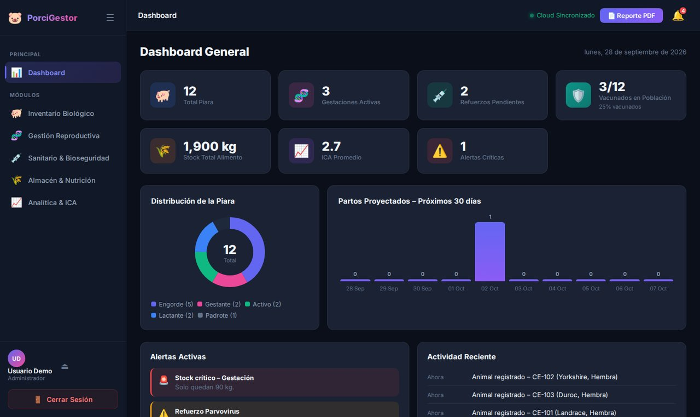
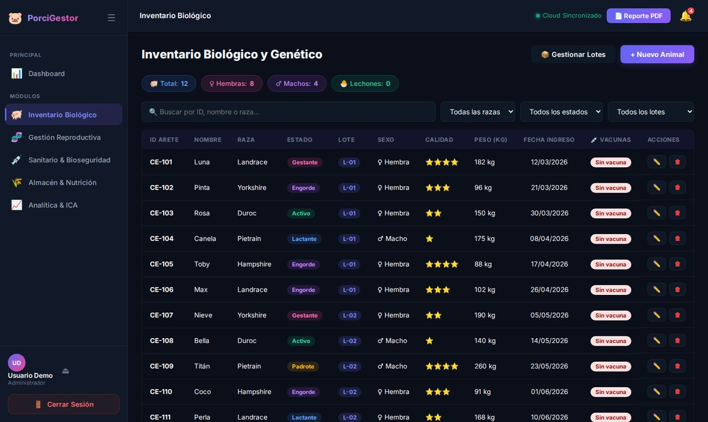
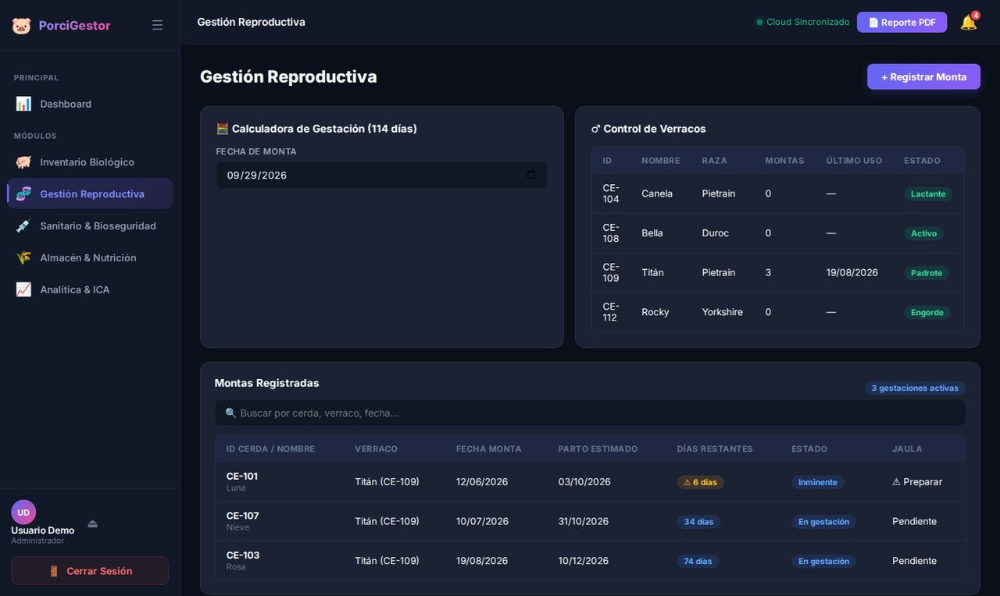
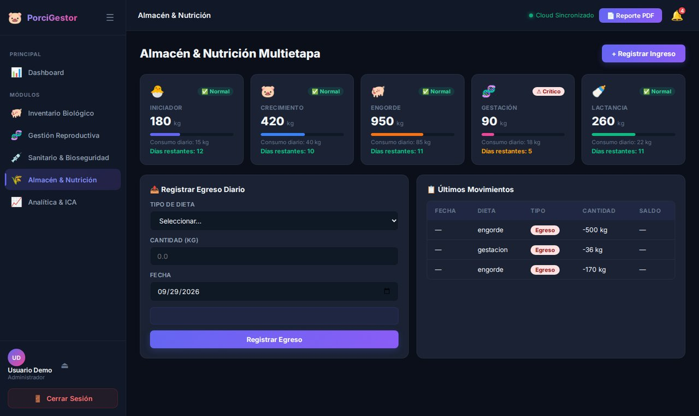
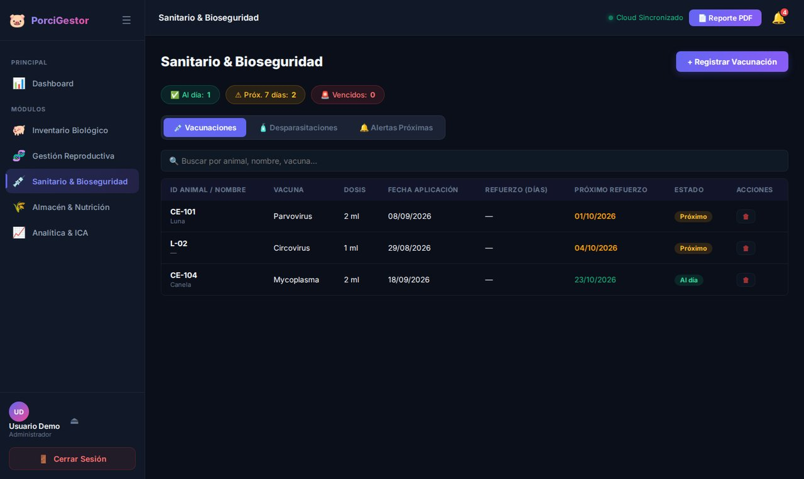
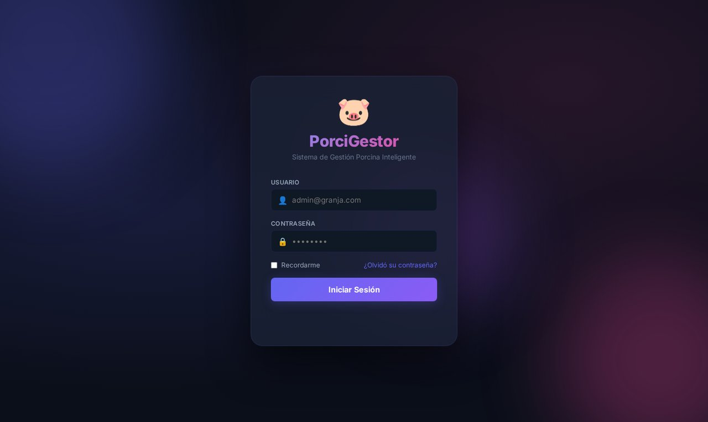

# 🐖 PorciGestor — Sistema de gestión para granjas porcinas

Aplicación web para administrar una granja de cerdos de principio a fin: inventario de animales, reproducción, sanidad, alimento y rendimiento. Los datos viven en **Supabase (PostgreSQL)**, así que se comparten en tiempo real entre todos los dispositivos de la granja.


---

## 📸 Capturas

<p align="center">
  
  
</p>
<p align="center">
  
  
</p>
<p align="center">
  
  
</p>

<sub>Capturas con datos de ejemplo.</sub>

---

## ✨ Módulos

| Módulo | Qué gestiona |
|---|---|
| **Dashboard general** | Resumen de la granja: animales, eventos próximos y alertas. |
| **Inventario biológico y genético** | Registro de cada animal, organización por **lotes**. |
| **Gestión reproductiva** | Montas y gestaciones con **fecha de parto proyectada** (114 días) y alertas de partos inminentes. |
| **Sanitario y bioseguridad** | Calendario de **vacunas** y **desparasitaciones**. |
| **Almacén y nutrición multietapa** | Stock de alimento e insumos con historial de **movimientos** (entradas/salidas). |
| **Analítica y rendimiento (ICA)** | **Pesajes** y cálculo del índice de conversión alimenticia. |

- **Roles**: *Administrador* (crea, edita y borra) y *Lector* (solo consulta; la interfaz entra en modo de solo lectura).
- Interfaz responsiva con barra lateral, notificaciones tipo *toast* y formularios modales.

## 🧱 Arquitectura

```
index.html          Estructura de la app y los módulos
style.css           Estilos (tema, layout responsivo, modo solo lectura)
app.js              Lógica: sesión, carga de datos y CRUD contra Supabase
config.example.js   Plantilla de configuración (copiar como config.js)
_headers            Cabeceras para despliegue en Cloudflare Pages / Netlify
```

Tablas en Supabase: `inventario`, `lotes`, `montas`, `vacunas`, `desparasitaciones`, `stock`, `movimientos`, `pesajes`.

## 🚀 Cómo ejecutarlo

1. Crea un proyecto gratis en [supabase.com](https://supabase.com) con las tablas de arriba.
2. Copia `config.example.js` como **`config.js`** y coloca tu URL, tu *anon key* y los usuarios.
3. Abre `index.html` con cualquier servidor estático:
   ```bash
   npx serve .
   ```

> 🔐 `config.js` está en `.gitignore`: tus claves nunca se suben al repositorio.
> El inicio de sesión de esta versión es del lado del cliente (pensado para uso interno); el siguiente paso natural es migrarlo a **Supabase Auth** con políticas RLS.

## 🌐 Publicar en internet

Es un sitio estático, así que se publica gratis en **Netlify** o **Cloudflare Pages** (el archivo `_headers` ya viene listo):

1. Crea tu `config.js` a partir de `config.example.js`.
2. En [app.netlify.com/drop](https://app.netlify.com/drop) arrastra la carpeta del proyecto **con** tu `config.js`.
3. Obtienes un enlace público al instante. En el teléfono, "Agregar a pantalla de inicio" lo deja como una app.

> No uses GitHub Pages para la versión real: `config.js` no está en el repo (a propósito) y el sitio no tendría conexión con la base de datos.

## Autor

**Dominic De Freitas** — Ingeniero en Informática (UGMA). Desarrollo aplicaciones móviles y web con React Native, TypeScript, Node.js y Python, y busco mi primer puesto como desarrollador junior remoto.

[Perfil de GitHub](https://github.com/dominic0285) · [LinkedIn](https://www.linkedin.com/in/dominic-de-freitas-07102828a/) · dominicdefreitasfd@gmail.com
